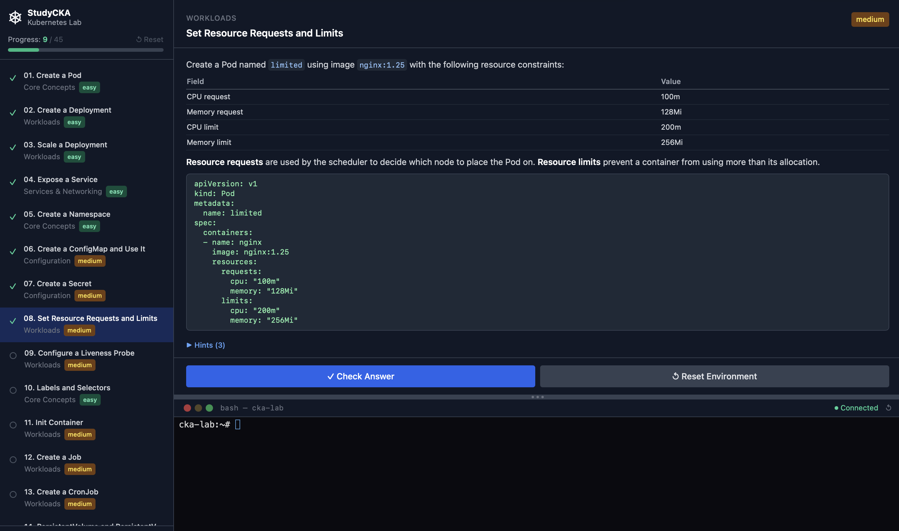

# StudyCKA ⎈

Practice for the Certified Kubernetes Administrator (CKA) exam with **58 hands-on exercises**. Use the built-in terminal to create workloads, diagnose failures and check your answers against a simulated Kubernetes cluster. The whole lab runs offline in your browser.

## Quick start

1. Download the repository and extract the ZIP.
2. Open **index.html** in your browser. Keep the extracted folders together.
3. Choose an exercise, work in the terminal and select **Check Answer**.

Your files, cluster and progress are saved in the browser’s localStorage. Reopen the same file in the same browser profile to pick up where you left off.

## Try the first exercise

Choose **01. Create a Pod**. Create an nginx pod in the default namespace, then check its status.

~~~sh
kubectl run nginx --image=nginx:1.25
kubectl get pod nginx
~~~

When the pod shows **1/1 Running**, select **Check Answer**.

## Exercises

| Exercises | What you’ll practice |
| --- | --- |
| 01–15 · Core skills | Create pods and deployments, expose services, configure storage and roll out updates. |
| 16–45 · Troubleshooting and scheduling | Diagnose crash loops, broken DNS, missing permissions and unschedulable pods. |
| 46–50 · Two-node clusters | SSH into a worker, repair its agent, drain a node and control pod placement. |
| 51–58 · Cluster and application management | Inspect image caches, bootstrap and upgrade with kubeadm, deploy with Helm and Kustomize, configure routing and autoscale workloads. |

Browse the [full exercise list](exercises/).

Terminal commands to try

| Task | Command |
| --- | --- |
| Inspect system pods | <code>kubectl get pods -n kube-system -o wide</code> |
| List images cached on this node | <code>crictl images</code> |
| Investigate a pod failure | <code>kubectl describe pod nginx</code> |
| Open a shell inside the pod | <code>kubectl exec -it nginx -- sh</code> |
| Edit a manifest | <code>vi pod.yaml</code> |

In Vi, press **i** to edit, **Esc** to finish editing, then type **:wq** and press **Enter** to save and exit.

Edit the app or add an exercise

Edit **index.html** for the layout, **style.css** for the design, and **js/app.js** for the interface. The terminal, editor and Kubernetes simulator are in [js/lab/](js/lab/). Save your changes and reload the page.

Each exercise has its own JavaScript file in [exercises/](exercises/). To add one, copy the [first exercise](exercises/01-create-pod.js), give it a unique ID and order, then add its script tag alongside the others in **index.html**. The local libraries in **vendor/** ship with the app.

To run the automated tests, use Node.js 22 or later from the repository root.

~~~sh
node --test tests/*.test.mjs
~~~

